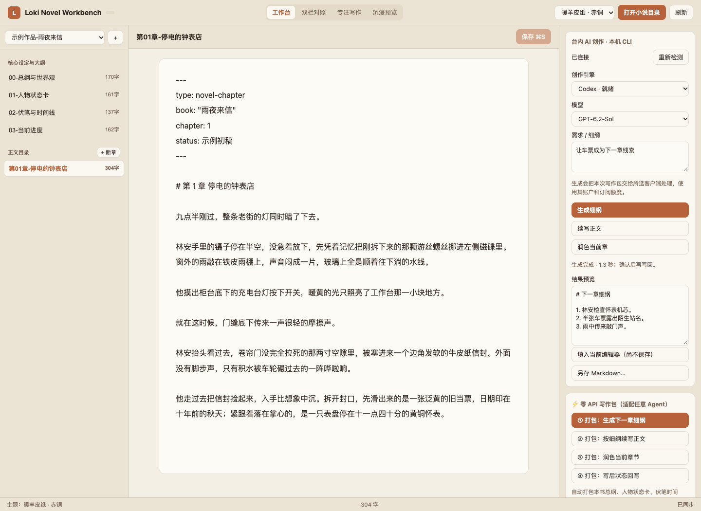

# Loki Novel Workbench · 赛博小熊猫的零 API 本地小说写作台

> 一个纯本地、零 API Key、兼容 Obsidian 的个人长篇小说写作台 Skill + 开箱即用脚手架。
>
> 把你攒下来的写小说 Skill、设定集、人物状态卡、伏笔账本和正文全部留在自己电脑本地，直接用你手头已订阅的 AI 会员 / 本地 Agent 完成从细纲、续写到润色的完整闭环。



## 为什么做这个？

之前我做过一个写长篇小说的网页版工具，但真正想分享给大家用时一直卡在两个现实问题上：

1. **API 配置门槛太高**：网页版强依赖自己接 API，而测下来最适合写中文小说的那几个模型，API 获取和接入对普通人来说太折腾了。
2. **大家手里其实早就有订阅会员**：很多人电脑上本来就在用桌面 Agent 或各种订阅制会员，如果只是想在本地给自己产粮、自娱自乐，完全没必要为了写小说再去额外买按量付费的 API。

所以干脆把这套从 0 到 1 搭本地小说台的过程，连同**脚手架脚本、5 套长篇档案模板、单页护眼写作台 HTML、写作包上下文协议**，全部打包成这个开源项目。

## 里面有什么（不止是一段提示词）

```text
loki-novel-workbench/
├── SKILL.md                           # Agent 技能入口（适配主流本地 Agent）
├── scripts/
│   └── init_library.py                # 零依赖 Python 脚手架：一键生成书架、模板、示例作品与单页写作台
├── assets/
│   ├── cli/                          # 本机桥接服务与 macOS 启动器
│   └── novel-workbench.html           # 开箱即用的纯本地单页写作台（49 套护眼主题 + 5 种模式 + 写作包）
├── templates/                         # 5 份长篇小说核心 Markdown 模板
│   ├── 00-总纲与世界观.md
│   ├── 01-人物状态卡.md
│   ├── 02-伏笔与时间线.md
│   ├── 03-当前进度.md
│   └── 章节模板.md
├── references/
│   ├── writing-pack-protocol.md       # 「写作包」上下文装配与写后状态回写协议（防止长篇吃书）
│   └── agent-workflow-guide.md        # 3 种零 API 订阅额度接入方式与安全红线
└── docs/
    └── preview-workbench.svg          # 界面结构预览图
```

## 核心特性

| 模块 | 能力说明 |
| :--- | :--- |
| **纯本地单一数据源** | 全部采用 UTF-8 Markdown 存储，无云端数据库，100% 兼容 Obsidian，换任何工具都不丢稿 |
| **防吃书四件套** | 每本书自带 `总纲与世界观` + `人物状态卡（含 OOC 红线）` + `伏笔与时间线` + `当前进度` |
| **护眼单页写作台** | 零构建、零外链依赖；默认内置 49 套低眩光护眼主题（暖羊皮纸、豆沙绿、云雾冷灰、深夜琥珀等），内置 35 套 Loki 外观与 14 套写作主题，无需另外下载皮肤包 |
| **5 种写作模式** | 工作台 / 双栏对照（默认两栏同步当前章，可在右栏选其他文档）/ 专注写作（Zen）/ 打字机 / 沉浸预览，支持 `Cmd+S` 直写本地 |
| **一键零 API 写作包** | 一键打包本书设定 + 人物状态 + 伏笔 + 上一章结尾 + 你的自定义写作 Skill，适配任意订阅制 AI |
| **台内 CLI 创作** | agy / Codex / Cola 真实模型目录与默认值；支持模型选择的客户端按次传参；自动继承本机代理，生成后先预览再保存 |
| **私有规则隔离** | 自动隐藏 `_写作规则与Skill/` 等下划线辅助目录，主书架只露你的作品 |

## 架构一览

```text
┌──────────────────────────────────────────────────────────────────┐
│                     Loki Novel Workbench                         │
├─────────────────────────┬────────────────────────────────────────┤
│  本地 Markdown 书架      │         单页写作台 (小说台.html)         │
│  ├── 00-书架总览.md      │  • 49 套护眼主题 & 字号/行距微调          │
│  ├── _写作规则与Skill/   │  • 双栏对照 / 专注写作 / 沉浸预览        │
│  ├── _模板/             │  • Cmd+S 直接写回本地磁盘                │
│  └── 你的小说目录/        │  • 一键复制「零 API 写作包」            │
│      ├── 00~03 四件套    │                                        │
│      └── 正文/           │                                        │
├─────────────────────────┴────────────────────────────────────────┤
│            零 API 创作驱动（复用你手头已有的订阅额度）                │
│   方式 A：桌面 Agent 直接读写目录  ｜  方式 B：写作包贴入网页会员     │
│   方式 C（进阶）：内置本机 CLI 桥接 + 桌面双击启动             │
└──────────────────────────────────────────────────────────────────┘
```

## 快速开始

### 方式一：作为 Skill 导入你的 AI Agent（推荐）

将本仓库放到你常用 Agent 的技能目录中，然后直接对你的 Agent 说：

> 用 `loki-novel-workbench` 在 `~/Documents/MyNovels` 帮我搭一个本地小说写作台

### 方式二：一行命令直接初始化（无需安装任何依赖）

下载或克隆本仓库后，在仓库根目录运行：

```bash
python3 scripts/init_library.py ~/Documents/MyNovels
```

执行完后，用 Chrome / Edge / Arc 打开 `~/Documents/MyNovels/小说台.html`，点「打开小说目录」选中 `MyNovels` 即可开始体验（内置纯虚构示例作品《雨夜来信》）。

### 方式三：在工作台内直接生成

初始化后，在生成的小说目录内运行（Python 3.9+）：

```bash
python3 server.py --open
```

macOS 可双击 `启动写作台.command`。默认打开 `http://127.0.0.1:8788/`；端口占用时运行 `python3 server.py --port 8789 --open`。服务默认加载当前初始化目录，也可登记已有书架目录；右侧统一写作助手检测已安装、已登录的客户端。

- **agy / Codex**：动态读取本机真实模型目录和默认值，支持单次选择模型与手动输入模型 ID。
- **Cola**：展示真实模型目录，生成跟随 Cola 客户端当前全局默认选择；当前 CLI 不支持单次指定模型。
- **网络**：继承终端代理，macOS 自动补入系统代理；本地请求绕过代理，无固定代理端口。
- **写回**：四种对话模式生成后先显示完整预览，点击「确认写回」才保存；取消时保留对话中的结果。续写、修改与 Skill 追加可撤销；文件已被其他窗口修改时拒绝覆盖。新章节保留为独立草稿，暂不提供删除式撤销。

更多兼容性、代理和排错说明见 [本地 CLI 协作指南](references/agent-workflow-guide.md)。

### 升级已有安装

```bash
python3 scripts/init_library.py /path/to/MyNovels --update-app
```

应用文件自动备份到目标目录的 `_workbench-backups/`，再更新页面、主题资源、服务、library.py 和启动器。小说、作者规则和已有模板不覆盖；自定义过的旧页面可从备份恢复。升级后重启服务。不加 `--update-app` 时仍保持已有文件不覆盖。

## 本次升级：按书绑定与统一写作助手

- 在书架根目录 `_style-cards/` 放 Markdown 风格卡，在 `_写作方法论/` 放写作 Skill；每本书可绑定一张卡和多份 Skill，创作与复制上下文包均携带选中的材料。目录不存在时显示空选项，不影响写作。绑定保存在当前浏览器 localStorage；换浏览器或原生 App 后需重新选择。
- 「✨ 智能」识别续写、开新章、改当前章、复盘修改；也可使用四个快捷模式。未创建的章号按新章处理。
- 手动与 AI 新建章节沿用已有数字章号的前缀、补零、分隔符和后缀；双栏默认对照同一章。
- 「停止」中止接收结果与写回，当前 CLI 进程可能继续运行到结束或超时，不能据此保证上游停止计费。
- `library.py` 修改后自动热重载；`server.py` 更新需重启。`workspaces.json` 为运行时私人登记文件，首次使用可自动以内置应用目录起步，不需要复制任何人的配置。

## 隐私与安全承诺

- **零外部 API Key**：不强制填写任何付费接口密钥，不接任何第三方反代网关。
- **本地存储**：工作台文件保存在本地，不接云端数据库。主动复制写作包到网页 AI 或点击 CLI 生成时，对应材料会发送给所选客户端及其模型服务商，使用该客户端的账户与额度。
- **零私货模板**：仓库内示例作品仅使用通用虚构测试稿，不含任何私人数据。

## 开发验证

```bash
python3 -B -m unittest discover -s tests -v
```

回归覆盖升级保稿、应用备份、代理继承、模型参数、错误提示和本地 HTTP 访问边界；真实 CLI 登录与模型调用需在本机另行验收。

## License

MIT — 欢迎自由使用、二次改造，注明来源 [Loki](https://github.com/loki2046-mao) 即可。
